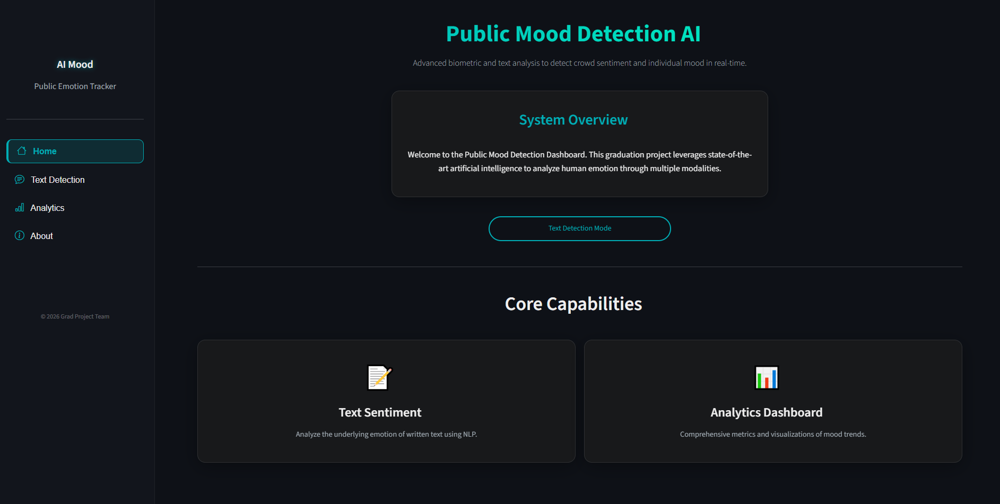
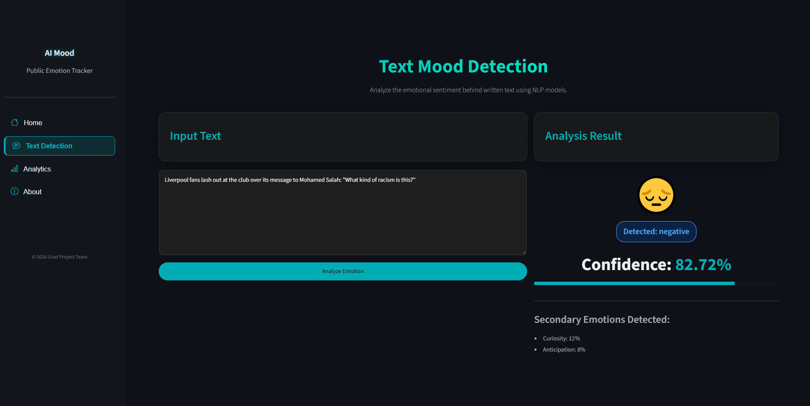
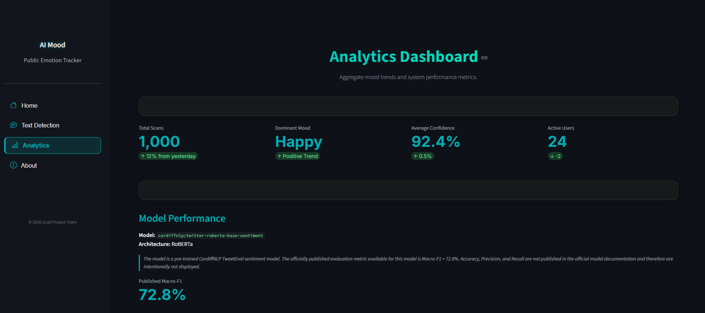
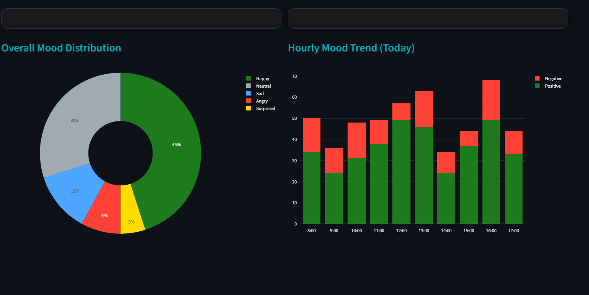

# Public Mood Detection

An interactive social media sentiment analysis application designed to detect and visualize public mood through text analysis.

## Project Overview

Public Mood Detection is a graduation project that provides an interactive interface for analyzing text sentiment and exploring sentiment trends through visual dashboards.

## Main Features

## Application Screenshots

### Dashboard


### Text Detection


### Analytics Overview


### Analytics Charts


- **Dashboard:** Overview of sentiment analysis and project insights.
- **Text Detection:** Analyze text and display its detected sentiment.
- **Analytics:** Explore sentiment trends and visual analytics.
- **About:** Information about the project and its objectives.
- **Project Team:** Introduction to the project team.

## Technologies Used

- Python
- Streamlit
- HTML
- CSS
- FastAPI
- Machine Learning / NLP

## My Contribution

**UI Design & Frontend Development**

My main responsibility in this project was designing and developing the user interface.

- Designed and organized the application pages.
- Developed the user interface using Streamlit.
- Customized the interface using HTML and CSS.
- Worked on presenting analysis results through a clear and user-friendly dashboard.

## Project Structure

```text
Public-Mood-Detection/
├── api/
├── ui/
├── .streamlit/
├── requirements.txt
├── server.py
└── start_project.bat
```

## Project Type

University Graduation Project

---

Developed as part of a Computer Science graduation project.
